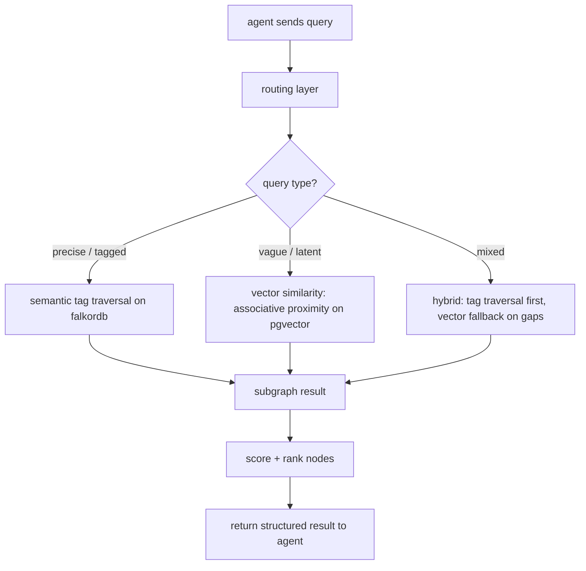
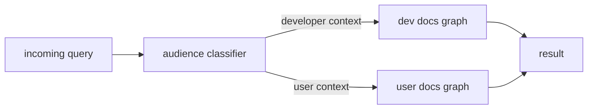
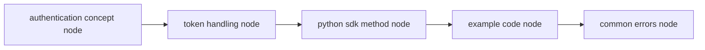
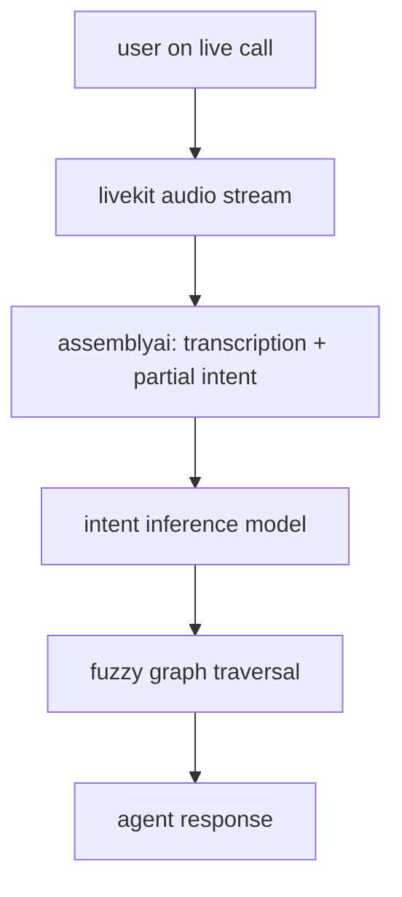

# agent.md

this file describes how agents interact with retelldb: what they receive, what they can do, and how the routing layer decides what retrieval strategy to use.

---

## what an agent gets from retelldb

when an agent sends a query, retelldb returns a structured result that includes:

- the retrieved nodes (with their content, type, and audience tag)
- the edges that connect them (so the agent knows why they are related)
- the retrieval path used (tag traversal, vector fallback, or hybrid)
- confidence signals per node

the agent does not need to know which retrieval strategy fired. that is handled by the routing layer internally.

---

## query flow



the "vague / latent" path is where the associative framing matters most. when a query has no clean tag match, retrieval falls back to proximity through the embedding space -- following conceptual closeness rather than explicit structure. [memorium](https://github.com/tinkrland/memorium) explores this kind of associative retrieval in the context of agentic memory; retelldb applies the same instinct to doc nodes. memorium is not part of retelldb but it is a useful reference for understanding why this fallback works the way it does.

---

## audience routing

retelldb maintains two separate graphs per project.



the classifier runs before retrieval. it uses a lightweight model call to determine whether the query context is developer-facing or user-facing, then routes to the correct graph. the two graphs never merge at query time.

if you are building an agent that serves both audiences, you pass an audience hint in the query payload and skip the classifier entirely.

---

## multi-hop traversal

this is the main reason retelldb uses a graph instead of flat vector chunks.

a query like "how do i authenticate with the python sdk" does not map to a single page. it maps to a chain:



the agent receives the full subgraph, not just the page that scored highest. it can reason over the chain rather than stitching together disconnected chunks.

---

## v2: live call mode

in v2, the agent can receive a real-time audio stream instead of a text query.



the agent does not wait for a clean, complete question. it starts traversing as soon as partial intent is available and updates its result as the transcription fills in.

---

## what agents should not do

- do not pass raw doc page urls as queries. ingest them through the pipeline first so the graph structure exists.
- do not try to pick the retrieval strategy yourself. the routing layer handles this. if you override it and force vector-only on a tagged query, you will get worse results.
- do not assume both graphs are always populated. check the graph status endpoint before querying if you are building something that depends on freshness.

---

## query payload shape

```json
{
  "query": "how do i refresh a token in the python sdk",
  "audience": "developer",
  "max_hops": 3,
  "top_k": 5,
  "include_edges": true
}
```

`audience` is optional if you want the classifier to decide. `max_hops` controls how deep the graph traversal goes. `include_edges` returns the relationship edges alongside nodes so the agent can explain its reasoning.

---

## what changed in the result

the result shape grew the fields an agent needs to behave honestly. everything is additive;
`nodes`, `edges`, `retrieval_path` and `confidence_signals` still work exactly as before.

| field | what it is for |
|---|---|
| `confidence.tier` | `high`, `uncertain`, `needs_clarification`, `unavailable` |
| `confidence.components` | which signal was weak: `hierarchy_decay`, `path_weight`, `persona_relevance`, `source_confidence` |
| `confidence.dominant_dampener` | the single weakest component, so the caveat can be specific |
| `confidence.next_actions` | `answer_directly`, `answer_with_caveat`, `ask_clarifying_question`, `state_unavailable`, plus recovery actions such as `switch_persona:<id>` |
| `paths` | the weighted walk that pulled each node in: node ids, edge ids, per-edge weights, chain weight, hops |
| `tag_resolutions` | how each matched tag resolved, including `alias` with its canonical tag |
| `blocked` | nodes withheld by the active perspective, with a reason and the personas that would expose them |
| `citations` | `path:line-line` references with content type, excerpt, and `verified` (true, false, or null when the source text is unavailable) |

### how to behave at each tier

- **high**: answer directly, cite the citations, no hedging.
- **uncertain**: answer, but say which component was weak. `dominant_dampener` tells you
  whether to mention age, perspective, traversal distance or source quality.
- **needs_clarification**: ask a question. do not guess between perspectives.
- **unavailable**: refuse, then offer the action in `next_actions`. if `blocked` names other
  personas, offer to switch; do not paraphrase blocked content or hint at it.

blocked content is not context. it never becomes a sentence, a hedge, or an omission that
implies you know. if `blocked` is non-empty and the tier is not `high`, say what you cannot
see and what would let you see it.
