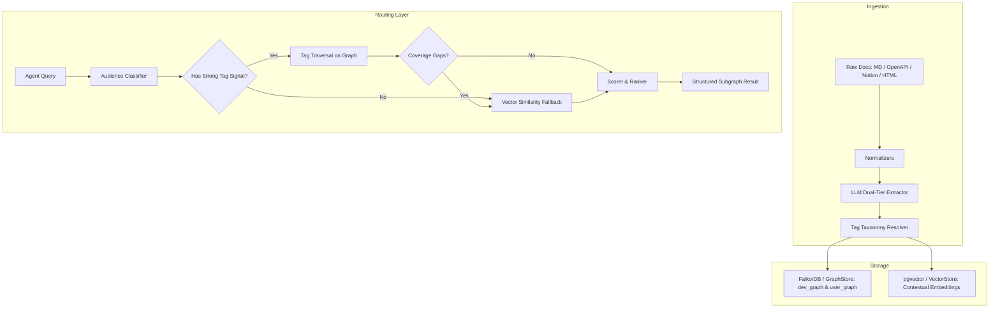

# retelldb

> a graph-powered retrieval layer for agents that actually understand your docs.

---

## what is this

retelldb is a retrieval engine built specifically for agents that work with documentation.

not support tickets. not chat history. docs. developer references, api guides, sdk pages, user-facing tutorials, the whole thing.

the problem with most doc search is that it treats every page like an isolated blob of text. retelldb models your docs as a graph, so an agent can actually traverse relationships between concepts, understand that this endpoint replaced that one, follow a "depends on" edge from a tutorial to a reference page, and know whether it is talking to a developer or a regular user before it even starts retrieving.

it also does semantic tag matching and latent vector similarity, so it catches both the precise lookups and the vague ones.

the latent similarity side of this is spiritually close to what [memorium](https://github.com/tinkrland/memorium) is doing with associative memory -- building dense connections between ideas rather than just retrieving from a flat bucket. retelldb borrows that framing for the doc retrieval problem: when there is no clean tag match, the fallback is not keyword search, it is proximity through the associative space of your docs.

---

## the core idea

your docs have structure. retelldb keeps that structure instead of flattening it away.

- concepts link to other concepts
- api pages link to the sdk methods that implement them
- versioned nodes know what they replaced
- tags sit as first-class edges, not metadata strings
- developer docs and user docs live in separate graphs so they don't pollute each other

when an agent queries retelldb, it can traverse that structure rather than just scoring text similarity against a pile of chunks.

---

## what it handles

- markdown, mdx, openapi / asyncapi specs, notion, html docs
- two separate graphs per project: one for developer docs, one for user docs
- semantic tag traversal and vector similarity fallback, both in the same query
- a routing layer that decides which retrieval strategy to use per query (this is core, not something you wire up yourself)
- self-hostable open source library or hosted api, your choice

---

---

## the tag wrangler

tags are the part of retrieval that decides everything downstream, so retelldb treats
them as a typed, auditable ontology instead of string metadata.

**canonical tags, aliases, and provenance.** a raw tag is never rewritten. an observed
`dev` or `coding` stays exactly as it was on the node, and the resolution is written to
the graph as an `alias_of` edge from the alias tag node to its canonical tag node, weighted
by confidence. you can always answer "what did the human actually type, and what did we
decide it meant".

**ambiguity resolves to nothing.** if an alias is configured for two canonical tags, it
resolves to neither and is reported as ambiguous. the wrangler does not guess from context
at ingest time.

**perspective is a retrieval parameter.** nodes can be stamped with personas and a
sensitivity. a query carries `persona`, and scope is fail-closed: no declared persona means
persona-scoped content is not visible, private content is only visible to its own persona,
and everything withheld comes back in `blocked` with a reason.

**weighted traversal, not nearest neighbour.** every edge carries an explicit weight. a
walk multiplies them along the path, prunes edges below a floor, refuses `blocks` edges, and
cannot loop. the result includes the path that pulled each node in, with its weights.

**confidence tiers and structured doubt.** the engine returns a total confidence, the tier
it falls in (`high`, `uncertain`, `needs_clarification`, `unavailable`), the components that
dampened it, and the next action the agent should take. a weak match is never dressed up as
a confident answer.

**citations you can check.** every node carries source references (path, line range, content
type). the engine resolves them into citations, and verifies the cited span against the
source text when it is available.

### generating the ontology

hand writing aliases does not scale, so the taxonomy can be generated from the tags a corpus
actually produces, using a dataset and model provider (Adaption Labs by default):

```bash
export ADAPTIONLABS_API_KEY=...
retelldb taxonomy generate ./docs --out taxonomy.yaml --dry-run   # inspect the prompt first
retelldb taxonomy generate ./docs --out taxonomy.yaml
retelldb taxonomy validate taxonomy.yaml
export RETELLDB_TAXONOMY_PATH=taxonomy.yaml
```

Adaption Labs is the default provider. `--provider openai-compat` points the same
generator at any chat-completions endpoint (`--base-url`, `--model`), which is useful when
the primary provider is unavailable.

the endpoint is `https://api.prod.adaptionlabs.ai/api/v1` (the docs call it `/v1`, the routes
carry the `/api` prefix): `GET /models`, `POST /responses`, `GET /health`. every request must
name a model, and the response is Responses-shaped, so the extractor reads `output_text` and
ignores the `reasoning` items rather than feeding chain-of-thought to the json parser.

`ADAPTIONLABS_BASE_URL` overrides the host (with or without the version suffix) and
`ADAPTIONLABS_MODEL` overrides the model. the default is `gemma-4-31b-it`, because the gateway
closes a request at 60s and that is what actually finishes in time on this corpus:

| model | 12-tag batch | taxonomy quality |
| --- | --- | --- |
| gemma-4-31b-it | ~22s | 31 canonical, 1 dangling reference, 3 uncovered (default) |
| gemma-4-26b-a4b-it | ~4s | 34 canonical but 16 dangling references |
| deepseek-v4-flash | ~35s | drifts past the window on some batches |
| glm-5.2, qwen3.8-27b | 60s timeout | reasoning models spend the whole window thinking, gateway 504s |

batching follows from the same limit: 12 tags per request (16 took 57s, 20 timed out), so
`--batch-size` defaults to 12 and `RETELLDB_TAXONOMY_BATCH` style overrides are not needed.

### unwrangled bins, the review queue

an ontology is only useful if you can see what it fails to cover. `taxonomy bins` ingests
documents against an existing ontology and groups the tags it could not place under the
canonical tags they were observed with:

```bash
retelldb taxonomy bins taxonomy.yaml docs/
# taxonomy.yaml: 10 bucket(s) across 6 document(s)
#   authentication <- auth, key, post, refresh, revoked, session, token, tokens
#   (no canonical nearby) <- billing, invoice, payment, pricing, subscription
```

this is otwarchive's model, not an invention: "Synning a fandom to a canonical fandom moves
its unwrangled tags to the canonical's unwrangled bins; de-synning takes them out"
(`features/tags_and_wrangling/tag_wrangling_more.feature`). the grouping signal is
co-occurrence on the same document, never string similarity, and a tag that appears with no
canonical at all stays unattributed rather than being guessed into a bin.

the same features settled two identity questions that string matching gets wrong: accent-only
differences are the same tag ("Amélie is considered the same as Amelie by the database" in
`tag_wrangling_special.feature`), while punctuation is not, so `Teal'c` and `Tealc` stay
distinct. `normalize_tag` folds diacritics and case for comparison and always preserves the
raw form in resolutions.

hierarchy follows `MetaTagging`: both ends canonical, same type, never itself, and no cycles,
so "a metatag can't be its own grandparent" is checked rather than assumed.

### semantic vs latent: what AO3 actually does

the reference implementation is otwarchive (`otwcode/otwarchive`), and the most useful thing
about reading it is what it does **not** have: no embeddings, no fuzzy matching, no automatic
wrangling. `app/models/tag.rb` only carries three explicit links, all human-authored:

| AO3 | means | encoded as | rules it enforces |
| --- | --- | --- | --- |
| synonym | same concept, different wording | `merger_id` self-FK on a noncanonical tag | merger must be canonical (`Tag#filter` returns it only then), same class, not itself |
| meta | "this tag is a superset of that one" | `MetaTagging(meta_tag, sub_tag)` | both canonical, same class, no self, no grandparent cycle |
| unwrangleable | do not wrangle this | `unwrangleable` flag | cannot be set on a canonical or a synonymized tag |

so the mapping retelldb uses, stated once in `retelldb/wrangling/relations.py` and printed by
`retelldb taxonomy validate`:

- **semantic similarity** (same words, a configured alias, a human or the generator naming the
  canonical) is the only thing that may create a **synonym**. it is the only relation that
  means "same concept".
- **latent similarity** may create an **association** with its cosine as the strength, and at
  0.9 and above it flags a **synonym candidate** for a human. it can never write the alias,
  because proximity is evidence about wording, not about identity.
- **cross-type pairs** get no relation at any similarity, which is AO3's same-class rule and
  what stops `jane austen` (person) merging into `pride and prejudice` (work) for being close.
- **below the threshold** is silence.

`tag_type` is now a tag field for exactly that reason, and the generator repairs what models
get wrong before anyone reads the file: one-sided associations are mirrored (the stronger claim
wins on disagreement), associations to tags the batch never produced are dropped, and a tag
aliased to itself is removed. all three are counted in the generation report, because a silent
repair is a repair nobody audits.

on the eval corpus the last run repaired 7 one-sided associations and 4 self-aliases, and left
2 `alias_shadows_canonical` violations that are a genuine merge decision (`installation` and
`setup` alias each other), which is what `taxonomy validate` is for.

### latent associations, proposed not asserted

memorium's rule is that embeddings are demoted from "the thing that understands the
knowledge base" to one component of retrieval: associations are explicit weighted edges a
human can inspect. retelldb keeps that line. vector distance never creates an edge at query
time, and one command does the job latent space is actually good at:

```bash
retelldb taxonomy generate docs/ --out taxonomy.yaml --associate     # generate, then propose
retelldb taxonomy associate taxonomy.yaml --out associations.yaml   # bind: review the proposals
retelldb taxonomy associate taxonomy.yaml --apply                   # accept them
```

`--associate` exists because the two passes belong to one build: the generator decides what
the canonical tags are, and the latent pass is the only thing that can say which of them sit
near each other. chaining them writes `taxonomy.yaml` and `taxonomy.associations.yaml`
together, and either pass can still be run alone.

the run embeds each canonical tag as its name plus aliases (the words humans actually
typed), compares every pair by cosine, and writes proposals with the raw similarity kept as
provenance. refreshing rules, all of them load bearing:

- below the threshold is silence, and the count of silences is reported
- an association already configured is skipped, so a reviewed weight is never overwritten
- an exclusion pair is never proposed, in either direction (`excludes` is now part of a tag)
- each tag keeps its strongest neighbours, so one hub cannot claim the whole taxonomy
- the run reports the corpus distribution (median, p90, pairs compared), because a threshold
  is only meaningful relative to the corpus it runs on

proposals are labelled with the same confidence tiers as retrieval (`high` from 0.75,
`uncertain` from 0.45). on the eval corpus, 32 canonical tags produced 55 proposals with the
corpus sitting at median 0.549 and p90 0.649: the top edges (`api` <-> `sdk` at 0.80,
`api` <-> `architecture` at 0.71) are the ones a human would draw, and the weak tail is
labelled weak instead of hidden.

the embedder is build-time only, like the generator: `retelldb/buildtime/featherless.py`
calls the Qwen3-Embedding family and raises when it cannot. it does **not** fall back to
retelldb's token projection, because token overlap is not latent space, and proposing tag
associations from it would dress a hash collision up as semantics.

### the provider is a build dependency, never a runtime one

generation runs during a build and its output is a reviewed `taxonomy.yaml` that ships with
the release. nothing in the retrieval path calls a model provider, and the package layout
makes that structural rather than conventional:

- the provider lives in `retelldb/buildtime/`, which the runtime never imports. a test boots a
  fresh interpreter, imports `retelldb`, `retelldb.client` and `retelldb.wrangling`, and fails if
  anything under `retelldb.buildtime` loaded.
- `retelldb/wrangling/generator.py` is provider agnostic: it takes any object with
  `available()` and `complete(system, prompt)`, so the generator can be tested with a stub and
  the ontology logic carries no vendor.
- `assert_build_time()` runs on construction and on every completion. if
  `RETELLDB_DEPLOYMENT`, `RETELLDB_ENV`, `DEPLOYMENT_ENV` or `ENVIRONMENT` says `production`,
  `prod` or `live`, the transport raises instead of making the call. there is no override flag
  on purpose.

generation is honest by construction: every observed raw tag must come back classified, tags
left uncovered are reported, a failed model call fails the command instead of writing a
partial ontology, and nothing is aliased until you point the config at the reviewed file.

## quickstart

### 1. Installation

```bash
pip install -e .
```

For external database drivers (FalkorDB, pgvector, LiteLLM):
```bash
pip install -e ".[all]"
```

### 2. Python SDK

```python
from retelldb import RetellDB

# Initialize client (defaults to in-memory mode if no external DB is configured)
client = RetellDB()

# Ingest documentation
client.ingest(
    content="""---
title: Authentication
tags: [auth, tokens]
---
# Authentication
## POST /v1/auth/token
Create an API session token.
```python
token = client.auth()
```
""",
    format="markdown",
    audience="developer"
)

# Precise query -> routes to Semantic Tag Traversal
result = client.query("how to generate auth tokens in python")
print(result.retrieval_path)  # tag_traversal
for item in result.nodes:
    print(f"[{item.node.type}] {item.node.title} (score: {item.score})")

# Vague query -> routes to Latent Associative Vector Fallback
vague_result = client.query("my credentials failed to connect")
print(vague_result.retrieval_path)  # vector_fallback

# Perspective, confidence, and citations
scoped = client.query("what should i work on", persona="student")
print(scoped.confidence.tier)        # high | uncertain | needs_clarification | unavailable
print(scoped.confidence.next_actions)  # what to do when the tier is not "high"
print(scoped.blocked)                # what this perspective could not see, and why
for citation in scoped.citations:
    print(citation.location(), citation.verified)  # docs/auth.md:6-7 True/False/None
```

### 3. Hosted API & Server

Start the hosted API server:

```bash
retelldb serve --port 8000
```

Endpoints:
- `POST /v1/query` — Run query through routing layer
- `POST /v1/ingest` — Ingest Markdown, OpenAPI, Notion, or HTML
- `GET /v1/status` — Inspect dev and user graph sizes and node types
- `GET /health` — Health check

Query via HTTP or connect a remote SDK client:

```python
client = RetellDB(base_url="http://localhost:8000")
result = client.query("how to authenticate")
```

### 4. CLI Usage

```bash
# Ingest a documentation file
retelldb ingest ./docs/api.md --format markdown --audience developer

# Query documentation
retelldb query "how do i refresh a token" --max-hops 3 --top-k 5

# Check graph status
retelldb status
```

---

## architecture



---

## stack

- [falkordb](https://falkordb.com) for the graph layer
- [pgvector](https://github.com/pgvector/pgvector) for vector similarity fallback
- [featherless.ai](https://featherless.ai) + [litellm](https://github.com/BerriAI/litellm) for inference
- python sdk + hosted api + cli

---

## ci

`.github/workflows/ci.yml` has two jobs. `test` runs the unit suite on the supported python
floor and ceiling, then gates on the eval hit rate. `integration` brings falkordb and pgvector
up from `docker-compose.yml` and runs the live-backend suite, which is why it only runs on
`main` and manual dispatch. Pull requests run `test` only.

the integration job is honest by construction: it installs the client libraries (the stores
silently fall back to memory without them) and fails on any skip, so a live test can never
quietly turn into a green build. it covers 24 tests across falkordb and pgvector, including
audience isolation and a fresh-database regression.

locally, `pytest -q -m "not integration"` runs the hermetic unit suite; the integration suite
needs `docker compose up -d` first. jobs run on **tenki runners** (`tenki-standard-small-2c-4g`),
which are a drop-in replacement for github-hosted runners: only the `runs-on` value differs.

one-time setup, done once per owner rather than per push: install the tenki github app for the
account that hosts this repository and grant it the repo (tenki dashboard -> runners -> github
connection). the repository currently lives at `arsoninstigator/retelldb` and moves back to the
`retelldb` org later, so no workflow value is org specific.
until that is done, jobs sit in the queue waiting for a runner with the tenki label instead of
failing.

## known issues & limitations

- **one eval miss left**: the golden query `dev_ingest_example` retrieves the example node
  (`Ingesting a Document - Example 1 (python)`) rather than its parent section, which the
  golden set expects by title. evaluation top-k hit rate is **92.3%** (12/13) on the
  `memory` backend, with 100.0% retrieval path and 100.0% audience routing accuracy. the
  known issue from the previous round (multi-tag overlap losing to hop proximity in the auth
  cluster) is fixed by weighted traversal plus duplicate-title collapsing.
- **generated ontologies need review**: `retelldb taxonomy generate` produces a taxonomy
  file, not a graph mutation. alias confidence is a model judgement, and the file is meant to
  be read before `RETELLDB_TAXONOMY_PATH` points at it.
- **citation verification needs source text**: without a `SourceVerifier` or a live file
  resolver, citations come back with `verified: null` rather than a claim.
- **persona coverage**: personas are only enforced where content was stamped with them at
  ingest. unstamped content is shared by default, which is a deliberate default but does mean
  a caller must decide visibility when it writes.

## v2

v2 adds a live call layer.

you open a call, mumble something half-formed like "how do i... the auth thing... with the token refresh", and the agent infers your intent from the audio in real time and traverses the graph to find what you actually meant. no need to type a precise query.

built on livekit and assemblyai.

