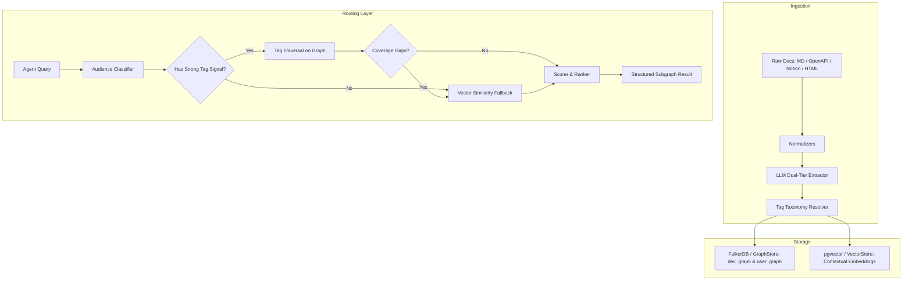

# retelldb

> a graph-powered retrieval layer for agents that actually understand your docs.

---

## what is this

retelldb is a retrieval engine built specifically for agents that work with documentation.

not support tickets. not chat history. docs. developer references, api guides, sdk pages, user-facing tutorials, the whole thing.

the problem with most doc search is that it treats every page like an isolated blob of text. retelldb models your docs as a graph, so an agent can actually traverse relationships between concepts, understand that this endpoint replaced that one, follow a "depends on" edge from a tutorial to a reference page, and know whether it is talking to a developer or a regular user before it even starts retrieving.

it also does semantic tag matching and latent vector similarity, so it catches both the precise lookups and the vague ones.

the latent similarity side of this is spiritually close to what [memorium](https://github.com/tinkrland/memorium) is doing with associative memory -- building dense connections between ideas rather than just retrieving from a flat bucket. retelldb borrows that framing for the doc retrieval problem: when there is no clean tag match, the fallback is not keyword search, it is proximity through the associative space of your docs.

---

## the core idea

your docs have structure. retelldb keeps that structure instead of flattening it away.

- concepts link to other concepts
- api pages link to the sdk methods that implement them
- versioned nodes know what they replaced
- tags sit as first-class edges, not metadata strings
- developer docs and user docs live in separate graphs so they don't pollute each other

when an agent queries retelldb, it can traverse that structure rather than just scoring text similarity against a pile of chunks.

---

## what it handles

- markdown, mdx, openapi / asyncapi specs, notion, html docs
- two separate graphs per project: one for developer docs, one for user docs
- semantic tag traversal and vector similarity fallback, both in the same query
- a routing layer that decides which retrieval strategy to use per query (this is core, not something you wire up yourself)
- self-hostable open source library or hosted api, your choice

---

## quickstart

### 1. Installation

```bash
pip install -e .
```

For external database drivers (FalkorDB, pgvector, LiteLLM):
```bash
pip install -e ".[all]"
```

### 2. Python SDK

```python
from retelldb import RetellDB

# Initialize client (defaults to in-memory mode if no external DB is configured)
client = RetellDB()

# Ingest documentation
client.ingest(
    content="""---
title: Authentication
tags: [auth, tokens]
---
# Authentication
## POST /v1/auth/token
Create an API session token.
```python
token = client.auth()
```
""",
    format="markdown",
    audience="developer"
)

# Precise query -> routes to Semantic Tag Traversal
result = client.query("how to generate auth tokens in python")
print(result.retrieval_path)  # tag_traversal
for item in result.nodes:
    print(f"[{item.node.type}] {item.node.title} (score: {item.score})")

# Vague query -> routes to Latent Associative Vector Fallback
vague_result = client.query("my credentials failed to connect")
print(vague_result.retrieval_path)  # vector_fallback
```

### 3. Hosted API & Server

Start the hosted API server:

```bash
retelldb serve --port 8000
```

Endpoints:
- `POST /v1/query` — Run query through routing layer
- `POST /v1/ingest` — Ingest Markdown, OpenAPI, Notion, or HTML
- `GET /v1/status` — Inspect dev and user graph sizes and node types
- `GET /health` — Health check

Query via HTTP or connect a remote SDK client:

```python
client = RetellDB(base_url="http://localhost:8000")
result = client.query("how to authenticate")
```

### 4. CLI Usage

```bash
# Ingest a documentation file
retelldb ingest ./docs/api.md --format markdown --audience developer

# Query documentation
retelldb query "how do i refresh a token" --max-hops 3 --top-k 5

# Check graph status
retelldb status
```

---

## architecture



---

## stack

- [falkordb](https://falkordb.com) for the graph layer
- [pgvector](https://github.com/pgvector/pgvector) for vector similarity fallback
- [featherless.ai](https://featherless.ai) + [litellm](https://github.com/BerriAI/litellm) for inference
- python sdk + hosted api + cli

---

## known issues & limitations

- **tag traversal ranker / auth cluster overlap**: In the developer graph, multi-tag overlap weighting does not yet consistently outrank hop proximity for densely cross-linked documents (specifically the authentication cluster). High-signal queries can retrieve hop-1 neighbors (such as `Authentication Architecture`) ahead of specific target sub-nodes when multiple matched tags connect to both. This produces three dev-graph misses (`dev_auth_token_refresh`, `dev_401_error`, `dev_ingest_example`), yielding an evaluation top-k hit rate of **76.9%** (10/13 queries passing) on both the `memory` and `falkordb` backends with 100.0% retrieval path and 100.0% audience routing accuracy (clearing the >=70% gate).
- **traversal scoring equivalence**: Memory BFS and FalkorDB Cypher path traversal should be scoring-equivalent; right now hop accounting and tie-breaking details between live Cypher traversal and in-memory BFS require calibration in round 3.

---

## v2

v2 adds a live call layer.

you open a call, mumble something half-formed like "how do i... the auth thing... with the token refresh", and the agent infers your intent from the audio in real time and traverses the graph to find what you actually meant. no need to type a precise query.

built on livekit and assemblyai.

