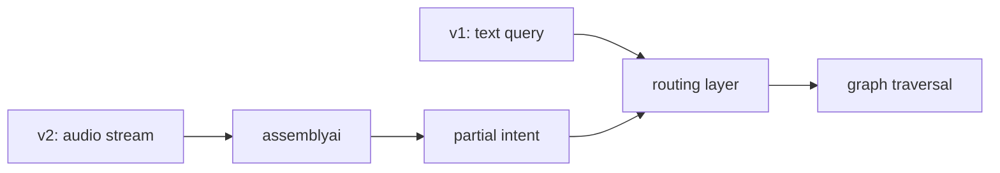

# scope.md

what retelldb is, what it is not, and what is planned.

---

## in scope

**graph-based retrieval for documentation**
retelldb models docs as a property graph. concepts, api references, code examples, and tutorials are nodes. the relationships between them are edges. retrieval traverses that structure.

**two separate graphs per project**
developer docs and user docs live in separate graphs. they have different schemas, different tag taxonomies, and different retrieval tuning. they never merge at query time.

**semantic tag traversal**
tags are first-class edges on the graph, not metadata strings stuffed into a search index. a query can traverse tag relationships directly without going through vector similarity at all.

**latent vector similarity fallback**
when a query does not match any tag path well enough, retelldb falls back to vector similarity via pgvector. this catches vague or underspecified queries that have no clean tag match.

**routing layer (core)**
the decision of which retrieval strategy to use is internal to retelldb. agents do not wire this up themselves.

**multi-format ingestion**
markdown, mdx, openapi / asyncapi specs, notion exports, html docs. everything normalizes to the same internal node shape before it hits the graph.

**tag ontology with provenance**
canonical tags, aliases with confidence, declared hierarchy and associations. raw tags are
preserved as provenance, and ambiguity resolves to nothing rather than a guess.

**perspective scoping**
personas and sensitivity as retrieval parameters, fail-closed, with every withheld node
reported and reasoned.

**weighted traversal and confidence tiers**
explicit edge weights, blocked edges, cycle termination, and a confidence verdict with
structured doubt and a next action.

**source citations**
path plus line range plus content type per node, with integrity checking against the source
when it is available.

**taxonomy generation**
build the ontology from the tags a corpus actually produced, reviewed as a file before it is
used.

**open source library + hosted api**
self-host the full stack or hit the hosted api. both are supported from the start.

---

## out of scope (v1)

**ticket or conversation history**
retelldb is not a support automation platform. it does not ingest chat logs, support tickets, or crm data. if that is what you need, look at forethought or similar.

**real-time audio queries**
live call mode with livekit and assemblyai is a v2 feature. v1 is text queries only.

**generating documentation**
retelldb retrieves from docs. it does not write or maintain them.

**fine-tuning models on your docs**
inference in retelldb uses featherless + litellm for routing and extraction. it does not fine-tune a model on your content. retrieval quality comes from the graph structure, not a tuned model.

**ui or chat interface**
retelldb is infrastructure. it is a library and an api. building a chat ui on top of it is your job (or your agent framework's job).

---

## v2 scope

**live call mode**
a user opens a call, speaks a vague or partial question, and the agent infers intent from the audio stream in real time. built on livekit for the call layer and assemblyai for transcription and partial intent extraction.

**fuzzy graph traversal from partial intent**
v2 traversal starts before the query is complete. as transcription fills in, the agent updates its traversal path. the graph structure makes this tractable because you are following edges rather than re-scoring every chunk from scratch.

---

## non-goals (permanent)

- retelldb will not become a general-purpose vector database
- retelldb will not replace your doc platform (confluence, notion, gitbook, etc.)
- retelldb will not manage auth, access control, or user sessions for your product
- retelldb will not hallucinate answers. it retrieves. the agent on top of it does the answering.
-
