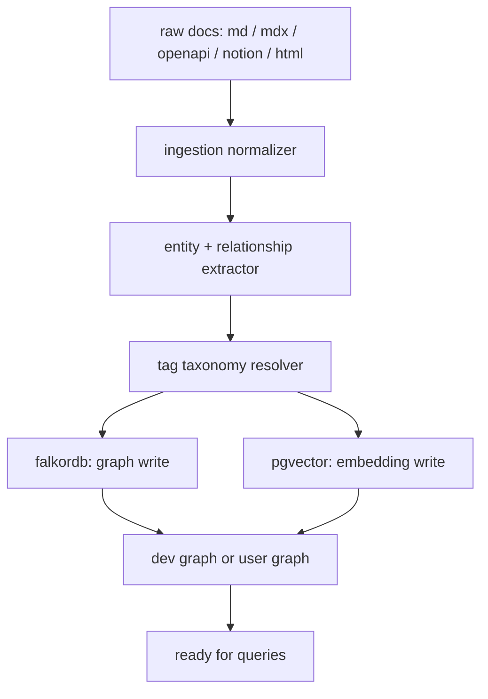
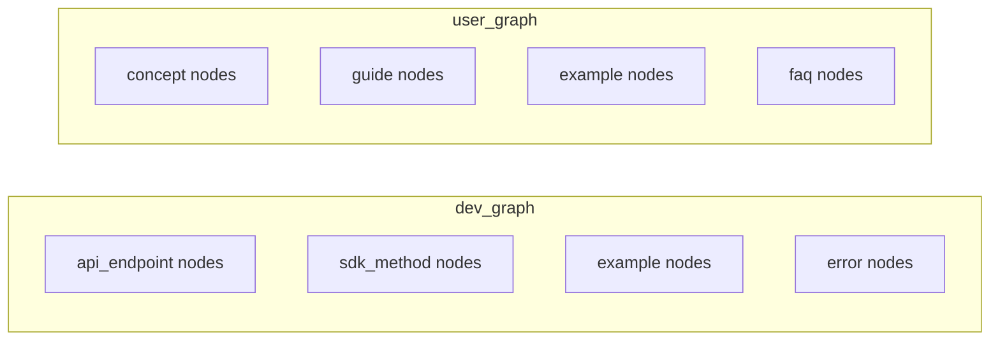
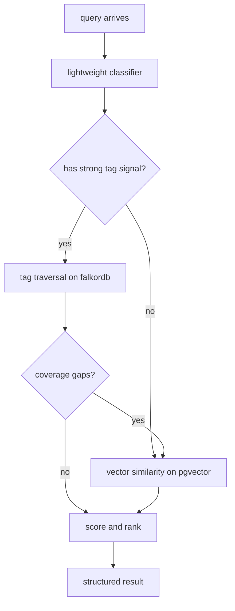
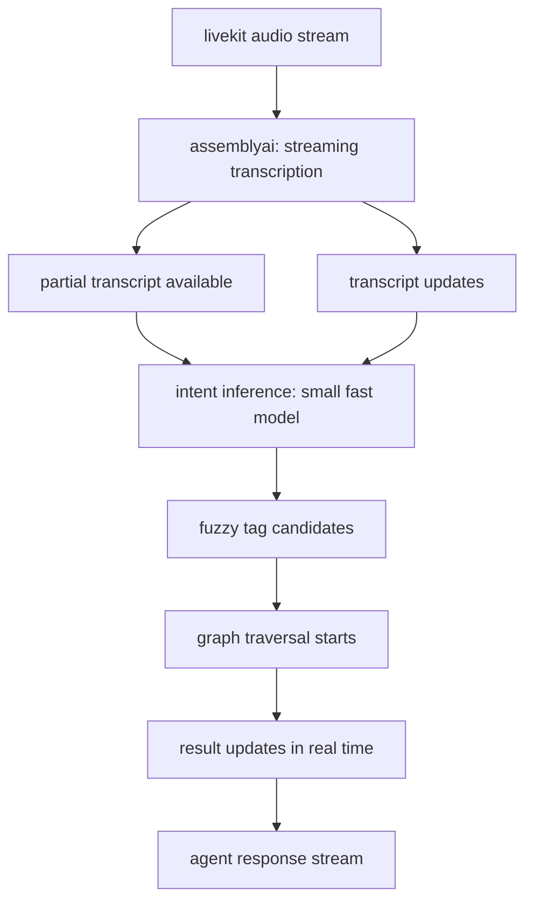

# under the hood

how retelldb actually works, from raw docs to a graph traversal result.

---

## the full pipeline



ingestion is the hardest part of the system. everything downstream depends on it being clean.

---

## ingestion normalizer

every source format gets converted to the same internal representation before anything touches the graph.

| source | what happens |
|---|---|
| markdown / mdx | frontmatter tags extracted, headings become structure nodes, code blocks typed as examples |
| openapi / asyncapi | endpoints, parameters, and schemas become typed nodes with explicit relationship edges |
| notion | blocks normalized to the internal format, page links become candidate edges |
| html docs | stripped and parsed for semantic structure, nav hierarchy used to infer relationships |

the output of the normalizer is a list of candidate nodes and candidate edges. nothing is written to falkordb yet.

---

## entity and relationship extraction

candidate nodes go through an llm extraction pass using featherless + litellm.

this is where the inference model split matters:

- a **small fast model** handles tag extraction and basic entity typing during ingestion. this runs at high volume and needs to be cheap.
- a **stronger model** handles ambiguous relationship inference, like deciding whether two pages are "related" or "depends on" or "replaces."

litellm makes this a config change, not a code change. you point each task at a different model identifier and the underlying provider (featherless) handles the rest.

---

## the graph schema

falkordb stores a property graph. the node and edge types look roughly like this:

**node types**

```
concept       a general idea or feature (e.g. "token refresh")
api_endpoint  a specific api route or method
sdk_method    a method in a client library
example       a code sample or tutorial step
guide         a full tutorial or walkthrough page
error         a known error or failure mode
```

**edge types**

```
depends_on    this node requires understanding of that node first
implements    this sdk_method implements this api_endpoint
replaces      this node is the successor to that node (versioning)
related       loose semantic relationship, lower traversal weight
tagged_as     connects any node to a semantic tag node
example_of    connects an example node to its parent concept or endpoint
```

tags are nodes too, not just string properties. this lets you traverse from a tag to everything tagged with it, or from a concept to all its tags, using the same cypher query syntax.

---

## the two graphs



they share the same schema shape but are separate falkordb graph instances. tag taxonomies are maintained independently. a `tagged_as` edge in the dev graph points to a dev-scoped tag node. same edge type, different tag namespace.

cross-graph edges do not exist at query time. if content genuinely belongs in both graphs, it gets ingested into both as separate nodes. the ingestion pipeline handles deduplication tracking.

---

## retrieval routing

the routing layer runs before any graph query fires.



"strong tag signal" means the query maps to one or more known tag nodes with high confidence. the classifier checks this first because tag traversal is faster and more precise than vector search.

if tag traversal returns a subgraph but leaves obvious gaps (e.g. no example nodes reachable within max_hops), the router fires a vector search to fill them in.

---

## vector similarity layer

pgvector stores embeddings on each node. the embedding is generated at ingestion time from the node's content plus its tag labels and edge context (neighboring node titles get appended so the embedding is context-aware, not just a raw chunk embedding).

at query time, the query is embedded using the same model and scored against the node embeddings for the target graph. top-k nodes are returned as candidates and merged with any graph traversal results before final ranking.

the conceptual framing here is close to what [memorium](https://github.com/tinkrland/memorium) calls associativity -- the idea that retrieval should work by following dense associative connections between ideas, not by fishing through a pile of text. memorium applies this to agentic memory persistence; retelldb applies the same instinct to documentation retrieval. the similarity score between a query embedding and a node embedding is essentially a measure of associative proximity: how conceptually close is this doc node to what you are asking, even if no explicit tag edge exists between them.

memorium is not a dependency or a component of retelldb. it is a related project worth reading if you want to understand the thinking behind why flat retrieval falls short.

---

## v2: live audio path



the key difference from v1 is that traversal starts on partial intent, not a complete query. assemblyai's streaming transcription emits partial results as the user speaks. each partial result triggers a lightweight intent inference pass that produces fuzzy tag candidates. the graph traversal runs against those candidates and updates as the transcript fills in.

this works well with a graph because traversal is incremental. you are following edges from a starting set of tag nodes outward. as the query gets clearer, the starting set narrows and the traversal tightens.

---

## inference model split

| task | model tier | why |
|---|---|---|
| tag extraction during ingestion | small / fast | high volume, structured output, cheap |
| relationship inference during ingestion | stronger | ambiguous decisions, runs once per doc |
| audience classification at query time | small / fast | latency-sensitive, binary-ish decision |
| intent inference in v2 audio path | small / fast | runs many times per call, needs to be real-time |
| final answer generation (agent layer) | your choice | not retelldb's job |

all model calls go through litellm. changing a model is a config key swap, not a code change.
